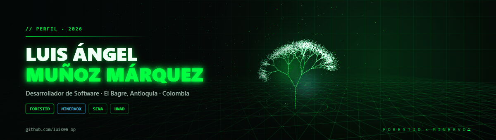
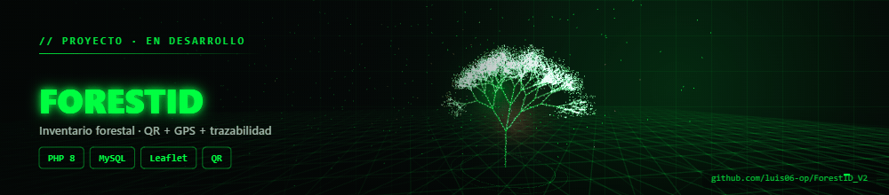
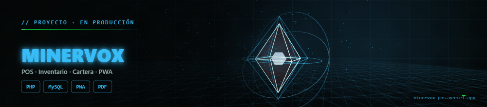
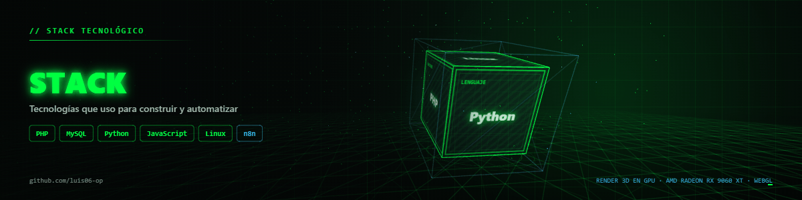

  

 

## `$ whoami`

<table>
<tr>
<td width="52%" valign="top">

### 👤 Luis Ángel Muñoz Márquez
`Desarrollador de Software en formación`

- 📍 **El Bagre, Antioquia** · Colombia
- 🎓 **Técnico en Programación de Software** — SENA · ficha 3412544
- 🌱 **Ingeniería Ambiental** — UNAD
- 💻 **Full-stack en formación:** PHP · MySQL · JavaScript · Python
- 🧪 **Explorando:** Linux · n8n · automatización
- 🏢 **Proyectos:** ForestID (Emincut S.A.S.) · Minervox

</td>
<td width="48%" valign="top">

### 🎯 En este momento

Construyo software para problemas reales: **del arbolado urbano al mostrador minero**.

- 🌳 Liderando la arquitectura de **ForestID**, una plataforma de trazabilidad forestal con QR y GPS.
- ⛏️ Desarrollando **Minervox POS**, un punto de venta PWA para insumos mineros.
- 📚 Formándome en programación, bases de datos y tecnología ambiental.
- ⚙️ Automatizando tareas con **Python**, **Linux** y **n8n**.

</td>
</tr>
</table>

## 🚀 Proyectos en los que estoy trabajando

### 🌳 ForestID V2 · ForestSRD

> Plataforma web integral para la **catalogación, monitoreo fitosanitario y trazabilidad histórica** del arbolado urbano y rural de **Emincut S.A.S.**, en El Bagre, Antioquia (Bajo Cauca antioqueño).

| | |
|---|---|
| **Mi rol** | Líder de Arquitectura |
| **Equipo** | Gabriel Correa · Michael Rodríguez · Valentina |
| **Contexto** | SENA Regional Antioquia · iRed Innovacción |
| **Stack** | PHP 8 · MySQL 8 · Tailwind CSS · JavaScript ES6+ · Leaflet · QR |
| **Estado** | 🟢 En desarrollo activo |

- 📍 Registro georreferenciado de cada árbol con **QR único + GPS**.
- 🗄️ Base de datos relacional con **UUID**, PDO y consultas preparadas.
- 📱 Escaneo en campo con cámara móvil y panel administrativo por roles.
- 📊 Tableros dasométricos y fitosanitarios con **Chart.js**.

### ⛏️ Minervox POS

> Sistema web **PWA** de punto de venta, facturación y control de cartera (*fiaos*) para comercializadoras de **insumos y reactivos químicos mineros**.

| | |
|---|---|
| **Mi rol** | Desarrollo full-stack |
| **Tipo** | PWA · Mobile-first |
| **Stack** | PHP 8 (POO + PDO) · MySQL/MariaDB · Tailwind CSS · JavaScript ES6+ · jsPDF |
| **Estado** | 🟢 En producción |

- 🧾 Facturación dual: **contado** y **crédito**.
- 📦 Inventario de sustancias controladas con alertas de stock mínimo.
- 💰 Cartera con semáforo de vencimientos, abonos y enlaces de cobro por **WhatsApp**.
- 📄 Pagarés y comprobantes en **PDF** generados al instante.

### 📂 Otros proyectos

| Proyecto | Qué es | Stack |
|---|---|---|
| [**counter_simulator.py**](https://github.com/luis06-op/counter_simulator.py) | Simulador de visitas concurrentes para analizar el comportamiento de cachés distribuidas | `Python` |
| [**ecuaciones-diferenciales**](https://github.com/luis06-op/ecuaciones-diferenciales) | Notebooks de Google Colab con soluciones y ejemplos de EDO | `Python` · `Jupyter` |
| [**Hoja-de-vida**](https://github.com/luis06-op/Hoja-de-vida) | Página web profesional de mi hoja de vida | `HTML` · `CSS` |
| [**Portafolio-de-Formación-**](https://github.com/luis06-op/Portafolio-de-Formaci-n-) | Portafolio personal de formación | `Web` |
| [**Tiling-Assistant**](https://github.com/luis06-op/Tiling-Assistant) | Extensión de tiling para GNOME (fork) | `JavaScript` |

## 🛠️ Stack tecnológico

### `// Lenguajes`

### `// Datos & herramientas`

### `// Aprendiendo ahora`

&nbsp;

### `// Renderizado en GPU`

| Detalle | Valor |
|---|---|
| **Motor 3D** | Three.js (WebGL 2) — geometría real, no imágenes planas |
| **GPU** | **AMD Radeon RX 9060 XT** · 16 GB · ANGLE / Direct3D 11 |
| **Escenas** | árbol holográfico · cristal minero · cubo de stack |
| **Post-proceso** | FFmpeg — paleta de 192 colores · 12,5 fps |
| **Rendimiento** | ~0,22 ms por fotograma en GPU |

## 🎓 Formación y certificaciones

### Formación académica

| Institución | Programa | Estado |
|:---:|---|---|
| **SENA** | Técnico en Programación de Software · ficha 3412544 | 🟢 En formación |
| **UNAD** | Ingeniería Ambiental | 🟢 En curso |

### Cisco Networking Academy

<table>
  <tr>
    <td align="center" width="25%">
       
      <b>Aplicación de la IA</b> 
      Cisco · 20 ago 2026
    </td>
    <td align="center" width="25%">
       
      <b>Introducción a la Ciberseguridad</b> 
      Cisco · 20 ago 2026
    </td>
    <td align="center" width="25%">
       
      <b>Introducción a la IA Moderna</b> 
      Cisco · 20 ago 2026
    </td>
    <td align="center" width="25%">
       
      <b>Fundamentos de Python 1</b> 
      Cisco · 16 jun 2026
    </td>
  </tr>
  <tr>
    <td align="center" width="25%">
       
      <b>Fundamentos de HTML</b> 
      Cisco · 03 sep 2026
    </td>
    <td align="center" width="25%">
       
      <b>Uso de computadoras y dispositivos móviles</b> 
      Cisco · 25 ago 2026
    </td>
    <td align="center" width="25%">
       
      <b>Encuentre información con IA</b> 
      Cisco · 25 ago 2026
    </td>
    <td align="center" width="25%"></td>
  </tr>
</table>

## 📊 Estadísticas

  

## 📫 Conecta conmigo

 

📍 El Bagre, Antioquia · Colombia &nbsp;|&nbsp; 🕒 GMT-5

  💡 <i>“Cada commit es un paso adelante.”</i>
    
  🎬 Banners 3D <b>renderizados en la GPU</b> (AMD Radeon RX 9060 XT · 16 GB) con Three.js + WebGL, y optimizados con FFmpeg.

